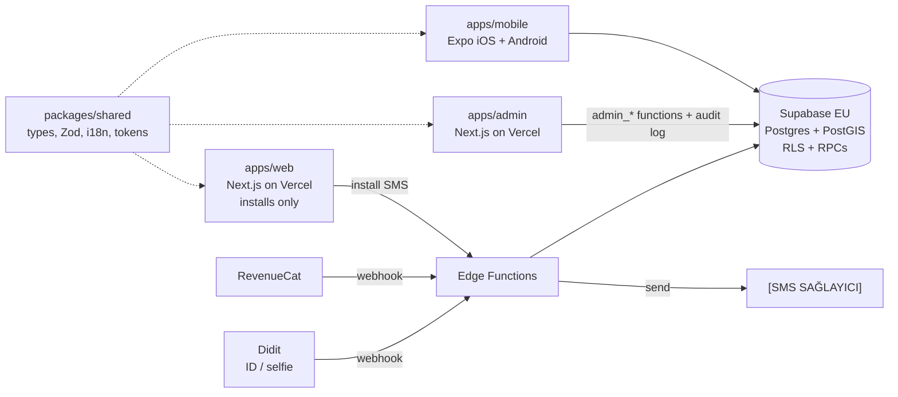

# Architecture — Touche

Rules and detail: repo `CLAUDE.md` (Stack, Architecture) and `docs/decisions/2026-11-14-stack.md`.

Business rules are enforced in Postgres (radius, mode separation, quota, Premium from the `premium_grants` ledger); clients only display results.
